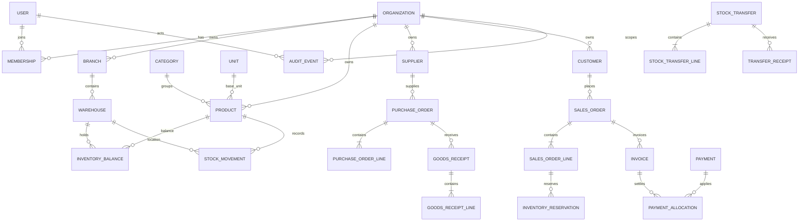

# Entity relationship overview

Every relationship is tenant-scoped. Add `organization_id` to bridge/document/line rows and enforce same-tenant foreign keys. The diagram omits auth/session, RBAC grants, product conversions, audit/outbox, imports/exports and subscription entities for readability. Exact optionality and cascade behavior must be encoded in migrations after approval. Never cascade-delete posted ledger or financial documents.
