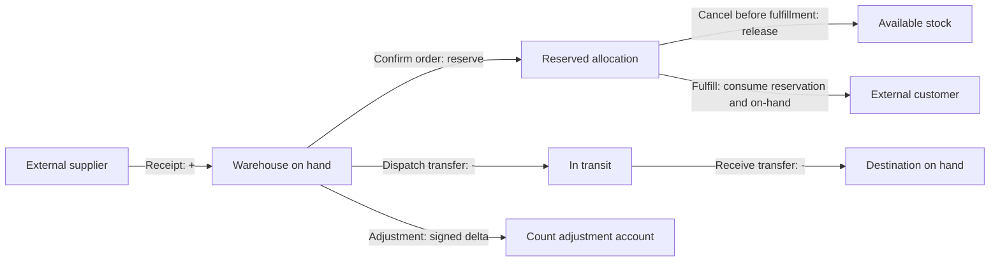

# Inventory state transitions and transaction invariants

**Status:** implementation contract based on the owner-authorized provisional defaults in DEC-007. These defaults are not validated accounting/customer requirements. Currency, tax, landed cost, and final valuation approval remain open under PROD-002.

## Quantity definitions

- `on_hand`: physical quantity at a warehouse. Reserved quantity remains physically on hand.
- `reserved`: the quantity allocated to confirmed, unfulfilled sales-order lines.
- `available`: `on_hand - reserved`; it may not be negative under the provisional strict policy.
- `in_transit`: quantity dispatched from a source warehouse but not yet accepted into a destination warehouse. It is not available to sell at either warehouse.
- Inventory quantities and movements are represented in the product's base unit. Sales document ordered/picked/fulfilled totals use the line's selected unit and are converted exactly before any ledger posting; UI does not add quantities expressed in different units.
- For sales picking, `picked` is cumulative confirmed quantity, including the portion already fulfilled. The line invariant is `0 <= fulfilled <= picked <= ordered`; picking is permission and reservation checked, and fulfillment cannot exceed the cumulative picked total.

## State flow

The diagram describes quantity flows; a command either commits its complete set of rows or commits none. Transfer out/in movements change warehouse `on_hand`; the outstanding transfer is tracked in the source balance's `in_transit` projection until receipt. There is no separate transit warehouse or transit movement in the on-hand ledger, so ledger reconciliation remains warehouse-specific. External receipts and adjustments retain their own documented counterpart semantics.

## Transition and rollback matrix

| Command                      | Preconditions                                                                                   | Committed quantity effects                                                                                                                                  | Atomic records                                                                                                           | Failure/rollback behavior                                                                                                                                                                                         |
| ---------------------------- | ----------------------------------------------------------------------------------------------- | ----------------------------------------------------------------------------------------------------------------------------------------------------------- | ------------------------------------------------------------------------------------------------------------------------ | ----------------------------------------------------------------------------------------------------------------------------------------------------------------------------------------------------------------- |
| Receive accepted goods       | Approved/receivable PO; positive base-unit quantity; idempotency key                            | Warehouse `on_hand += q`; `in_transit` unchanged                                                                                                            | Receipt and lines, inbound movement, balance projection, cost snapshot, audit and outbox                                 | Any validation, uniqueness, or write failure rolls back all rows. A retry with the same key and payload returns the committed receipt.                                                                            |
| Confirm sales order          | Draft order; each line has sufficient `available`; lock affected balances in stable order       | `reserved += q`; `on_hand` unchanged; `available -= q`                                                                                                      | Order state/version, reservation rows, audit and outbox                                                                  | If any line is short or a concurrent order wins, no line is reserved and order remains draft.                                                                                                                     |
| Cancel unfulfilled order     | Confirmed order; no fulfilled quantity                                                          | Release each remaining reservation once: `reserved -= q`; physical quantity unchanged                                                                       | Order state/version, reservation state, audit and outbox                                                                 | A retry cannot release twice. If any line has shipped, reject cancellation; use an approved return workflow later.                                                                                                |
| Fulfill reserved order lines | Confirmed order; requested quantity is reserved and pick/fulfillment bounds hold                | For q fulfilled: `on_hand -= q` and `reserved -= q`; available unchanged by consumption of the reserved amount                                              | Shipment/fulfillment, reservation consumption, outbound movement, balance, audit and outbox                              | All lines in the command roll back together. A duplicate idempotency key cannot consume twice.                                                                                                                    |
| Dispatch stock transfer      | Submitted transfer; source has `available >= q`; destination belongs to same organization       | Source `on_hand -= q`; source `in_transit += q`                                                                                                             | Transfer state/version, source `TRANSFER_OUT` movement, balance projection, audit and outbox                             | All lines roll back together. Insufficient available stock leaves transfer submitted.                                                                                                                             |
| Receive transfer             | Dispatched quantity remains unreceived; destination is active and same-tenant                   | Source `in_transit -= q`; destination `on_hand += q`; source on-hand remains reduced                                                                        | Transfer receipt, destination `TRANSFER_IN` movement, both balance projections, transfer state/version, audit and outbox | Receipt, movement and both balances roll back together. Replayed receipt key does not double receive. Short receipt leaves the outstanding amount in the source in-transit projection for later receipt.          |
| Post stock count adjustment  | Authorized count with reason; adjustment does not make `on_hand < reserved` under strict policy | Signed delta to warehouse `on_hand`; `reserved` unchanged                                                                                                   | Adjustment document/version, movement, balance, audit and outbox                                                         | Negative available or invalid count is rejected before posting. Posting failure leaves the adjustment unposted and balance untouched.                                                                             |
| Reverse a posted transaction | Original is posted and not already fully reversed; authorized compensating document             | Append exact compensating movements linked to original; update balance projections by the inverse effect, subject to strict availability/reservation checks | Reversal document, linked movements, balances, audit and outbox                                                          | Never edit/delete the original. The reversal and projections commit together or roll back together. If reversal would violate current constraints, reject and require an explicitly approved resolution workflow. |

### Invariants

1. For every warehouse/product, `available = on_hand - reserved` and both `reserved >= 0` and `available >= 0`. `in_transit >= 0` is tracked separately.
2. Transfer dispatch and receipt are quantity-balanced across warehouse/transit locations; partial receipt leaves exactly the outstanding dispatched amount in the source balance's `in_transit` projection. The movement ledger contains source `TRANSFER_OUT` and destination `TRANSFER_IN` entries only.
3. Posted stock movements are append-only. Corrections are new, linked compensating movements; a reversal cannot exceed the un-reversed original quantity.
4. A stock-changing command writes document state, movement(s), balance projection(s), audit event(s), idempotency result, and outbox event(s) in one database transaction.
5. Lock all affected balance keys in deterministic `(organization_id, warehouse_id, product_id)` order. Check availability after acquiring locks. Do not rely on UI validation.
6. A unique organization-scoped idempotency key is bound to a canonical payload hash. Same key/same hash returns the original outcome; same key/different hash returns conflict.
7. Moving weighted average is a provisional cost policy. Inbound accepted stock updates average cost from existing on-hand value plus accepted receipt value; outbound and transfer costs carry a snapshot. Transfers preserve source cost snapshot. Landed costs, FX, and financial accounting entries are out of scope pending owner/accountant review.
8. If a database transaction aborts, no partial document, movement, reservation, balance, audit, idempotency completion, or outbox event remains. Once committed, a caller timeout is resolved by idempotent replay, not by deleting committed rows.

## Required scenario review before implementation

| Scenario                                                                      | Expected result                                                                                               |
| ----------------------------------------------------------------------------- | ------------------------------------------------------------------------------------------------------------- |
| Two confirmations compete for the final available unit                        | Exactly one succeeds under strict no-negative policy; the other creates no reservation.                       |
| Same receipt/transfer/fulfillment request is replayed                         | One document effect and one set of movements; response resolves to the original result.                       |
| Same idempotency key is reused with a different payload                       | Conflict and no new writes.                                                                                   |
| Partial transfer receipt                                                      | Received amount reaches destination; outstanding amount remains in transit.                                   |
| Cancellation is replayed                                                      | Reservation is released exactly once; shipped order cancellation is rejected.                                 |
| Failure after a movement insert but before projection/audit/outbox completion | Transaction rollback leaves all persistent state unchanged.                                                   |
| Reversal is requested twice                                                   | Only one compensating quantity is posted; subsequent duplicate is idempotent or rejected as already reversed. |
| Adjustment count is below existing reservations                               | Rejected; reserved allocations cannot be silently invalidated.                                                |

These scenarios describe the implementation contract. Coverage and the exact verification run for each milestone are recorded in `docs/progress/current-state.md` and `docs/progress/next-session.md`.

## Sales reservation and fulfillment verification (2026-11-08)

The isolated PostgreSQL integration suite covers competing confirmation, insufficient availability, idempotent confirmation, cancellation release/replay, tenant denial, partial/multiple picking, over-pick rejection, fulfillment-before-pick rejection, partial/full fulfillment, pick/fulfillment retry and races, warehouse grants, pick/fulfillment outbox rollback, and final reservation/ledger reconciliation. SALES-003 implementation and database acceptance passed; authenticated browser acceptance is still unavailable, so the task remains IN_PROGRESS.

## CSV and opening balance import contract (2026-11-08)

Product import is create-only: an existing organization SKU/barcode or duplicate in the same file is a row error; commit requires every row to be valid and creates the entire batch atomically. Preview has no product or inventory side effects and expires after 24 hours. Opening balance import uses a conservative initialization policy: each product/warehouse pair must have no prior movement history and a zero/no balance projection. It posts an immutable `OPENING_BALANCE` movement through `InventoryPostingService`, including source batch/line references, audit, outbox and idempotency in one transaction. It never overwrites live stock. This is provisional operational behavior rather than an owner-validated accounting rule. Isolated PostgreSQL coverage includes preview/no-side-effect, replay, invalid row rejection and injected outbox rollback for both product and opening-stock commits.
