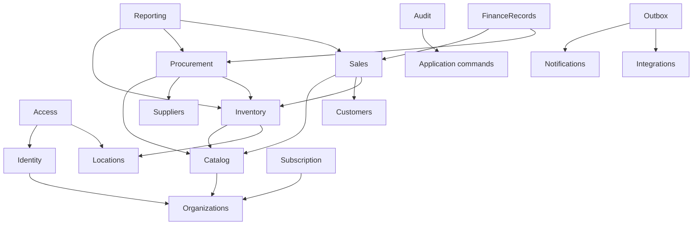

# Module dependency map

Rules: dependencies point toward shared domain contracts; avoid circular direct imports. Catalog defines product/UoM identity. Inventory owns movements, reservations and balances. Procurement/Sales request inventory domain commands rather than writing balances. Finance records do not claim full general-ledger accounting. Reporting uses query services/read models and cannot post transactions. Audit is cross-cutting. Integrations consume committed outbox events; they cannot be synchronous preconditions for core stock posting.

Build order follows `task-breakdown.md`: repo foundation → identity/tenancy/access → locations/catalog → ledger → procurement/sales/transfers → reporting → quality/deploy.
