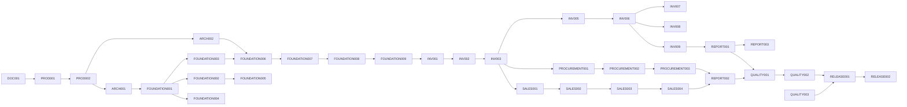

# Task dependency map

P2/P3 work is gated by pilot evidence and stable MVP ledger: P2-001 → P2-002 → P2-003; P3-001/P3-002/P3-003 depend on approved scope, security and core API stability. `task-breakdown.md` is the authoritative task dependency/status ledger.
